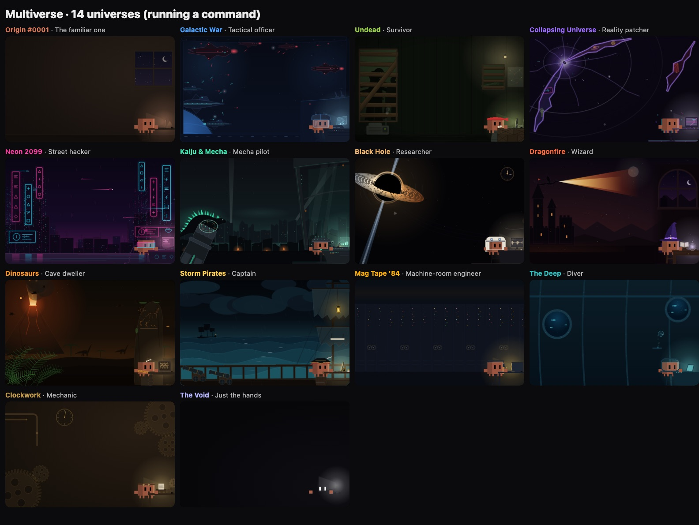

# Claude Multiverse

A theme mod for Claude Code. Every new session lands in one of fourteen dark universes, and the Claude critter
works at its desk there: it thinks, types, reads, runs commands, hits errors and stretches when it's done.
Subagents arrive through portals from other universes.



[Tiếng Việt](#tiếng-việt)

## Install

At the prompt of a terminal session:

```
/plugin install multiverse --marketplace Nam0101/claude-multiverse
```

Answer `y` to add the marketplace, then pick a scope (user scope loads it in every session).

From a shell:

```bash
claude plugin install multiverse --marketplace Nam0101/claude-multiverse
```

In the desktop app, where `/plugin` does not run: click **+** next to the prompt box, then **Plugins**,
**Add marketplace** with `Nam0101/claude-multiverse`, then **Add plugin**.

The animated backdrop and the tiny Claude above the prompt show in the Claude desktop app and the mobile app.
In a terminal you get the universe's name in the mode line.

## The universes

| Universe | Claude is | Feel |
| --- | --- | --- |
| Origin #0001 | the familiar one | calm |
| Galactic War | a tactical officer on a warship bridge | intense |
| Undead | a survivor in a boarded-up room | intense |
| Collapsing Universe | a reality patcher | intense |
| Neon 2099 | a street hacker | intense |
| Kaiju & Mecha | a mecha pilot | intense |
| Black Hole | a researcher at the event horizon | intense |
| Dragonfire | a wizard in a castle tower | intense |
| Dinosaurs | a cave dweller | intense |
| Storm Pirates | a captain on deck in a storm | intense |
| Mag Tape '84 | a machine-room engineer | calm |
| The Deep | a diver in a diving bell | calm |
| Clockwork | a mechanic in a brass workshop | calm |
| The Void | just the hands | rare |

Intense universes come up more often. Each one has its own color palette for the whole app.

## What moves

- **Activity.** Thinking, writing, reading files, running commands, searching the web, errors and done each have
  their own pose and their own reaction in the scene.
- **Subagents.** Each running subagent opens a portal (up to three) on a Claude from another universe. A small
  Claude flies out to open it.
- **Ultra.** `/effort ultracode`, or "ultracode" / "ultrathink" in a prompt, powers the desk up with a golden aura.
- **Context.** Papers and cups pile up on the desk as the context fills; `/compact` clears them.
- **Landing.** A new session shows the universe's name for a few seconds.

## Commands

| Command | Does |
| --- | --- |
| `/multiverse list` | lists every universe |
| `/multiverse next` | jumps to another universe |
| `/multiverse <name>` | goes to a universe by name, e.g. `/multiverse the deep` |
| `/multiverse ultra` | toggles ultra for the session |
| `/multiverse panels both \| left \| right \| off` | says which side panels of the desktop app are open |
| `/multiverse panels <left px> <right px>` | sets the panels' widths |

### Side panels

The desktop app draws the backdrop under its sidebar and right-hand panel, and doesn't tell a mod which ones are
open. So the mod assumes both are open (260 px left, 320 px right) and fits the picture into the strip between
them, with Claude to the right of the chat. If you keep a panel closed, tell it: `/multiverse panels right`,
`/multiverse panels off`, or exact widths with `/multiverse panels 280 360`. The setting carries over to new
sessions.

## License

MIT, see [LICENSE](LICENSE). `hooks/make-colors.js` and `hooks/make-colors.d.ts` come from Claude Code's
plugin-authoring kit and are not covered by it.

---

## Tiếng Việt

Mod giao diện cho Claude Code. Mỗi phiên mới rơi vào một trong mười bốn vũ trụ tối, và chú Claude ngồi làm việc ở
bàn của mình trong đó: suy nghĩ, gõ phím, đọc file, chạy lệnh, gặp lỗi, vươn vai khi xong. Subagent hiện ra qua
những cánh cổng từ vũ trụ khác.

### Cài đặt

Trong một phiên terminal, gõ ở ô nhập:

```
/plugin install multiverse --marketplace Nam0101/claude-multiverse
```

Trả lời `y` để thêm marketplace, rồi chọn scope (scope user nạp mod ở mọi phiên).

Trong app desktop (không chạy được `/plugin`): bấm **+** cạnh ô nhập, chọn **Plugins**, **Add marketplace** với
`Nam0101/claude-multiverse`, rồi **Add plugin**.

Phông nền động và chú Claude nhỏ phía trên ô nhập hiện trong app desktop và app điện thoại. Trong terminal thì
chỉ có tên vũ trụ ở dòng chế độ.

### Lệnh

- `/multiverse list`: kể tên các vũ trụ.
- `/multiverse next`: nhảy sang vũ trụ khác.
- `/multiverse <tên>`: tới một vũ trụ theo tên, ví dụ `/multiverse dragonfire`.
- `/multiverse ultra`: bật hoặc tắt ultra cho phiên.
- `/multiverse panels both | left | right | off`: báo những thanh bên nào của app desktop đang mở.
- `/multiverse panels <trái px> <phải px>`: đặt độ rộng hai thanh.

### Thanh bên

App desktop vẽ phông nền dưới thanh bên trái và panel bên phải, và không cho mod biết thanh nào đang mở. Vì vậy
mod mặc định coi như cả hai đang mở (trái 260 px, phải 320 px), rồi co bức tranh vào dải ở giữa, với Claude đứng bên
phải khung chat. Nếu bạn đóng một thanh, hãy báo cho mod: `/multiverse panels right`, `/multiverse panels off`,
hoặc độ rộng chính xác như `/multiverse panels 280 360`. Cài đặt được nhớ sang các phiên sau.

### Giấy phép

MIT, xem [LICENSE](LICENSE). Hai file `hooks/make-colors.js` và `hooks/make-colors.d.ts` lấy từ bộ công cụ
plugin-authoring của Claude Code và không thuộc giấy phép này.
