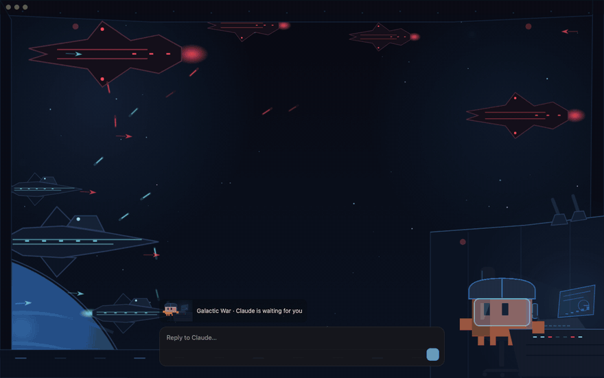

# Claude Multiverse

A theme mod for Claude Code. Every new session lands in one of a hundred and fourteen dark universes, and the Claude critter
works at its desk there: it thinks, types, reads, runs commands, hits errors and stretches when it's done.
Subagents arrive through portals from other universes.

Whichever universe it lands in, Claude is the same hard worker. Under fire on a warship bridge, behind boarded-up
windows with the undead outside, or in a reality coming apart at the seams, it sits down at its desk and gets the job
done.



*Recorded from the mod's own scenes and above-prompt band; the window around them is a mock-up.*

[Tiếng Việt](#tiếng-việt)

## Install

At the prompt of a terminal session:

```
/plugin install multiverse --marketplace Nam0101/claude-multiverse
```

Answer `y` to add the marketplace, then pick a scope (user scope loads it in every session).

From a shell:

```bash
claude plugin install multiverse --marketplace Nam0101/claude-multiverse
```

In the desktop app, where `/plugin` does not run: click **+** next to the prompt box, then **Plugins**,
**Add marketplace** with `Nam0101/claude-multiverse`, then **Add plugin**.

The animated backdrop and the tiny Claude above the prompt show in the Claude desktop app. The mobile app doesn't
draw them, at least over Remote Control. In a terminal you get the universe's name in the mode line, and while ultra
is on a sparking ULTRA row above the prompt.

## The universes


| Universe | Claude is | Feel |
| --- | --- | --- |
| Origin #0001 | the familiar one | calm |
| Galactic War | a tactical officer on a warship bridge | intense |
| Undead | a survivor in a boarded-up room | intense |
| Collapsing Universe | a reality patcher | intense |
| Neon 2099 | a street hacker | intense |
| Kaiju & Mecha | a mecha pilot | intense |
| Black Hole | a researcher at the event horizon | intense |
| Dragonfire | a wizard in a castle tower | intense |
| Dinosaurs | a cave dweller | intense |
| Storm Pirates | a captain on deck in a storm | intense |
| Red Planet | a colonist in a habitat dome | intense |
| Wild West | a telegraph operator in a frontier town | intense |
| Pharaoh's Tomb | a scribe in a torchlit tomb | intense |
| Lightning Lab | a mad scientist at the big lever | intense |
| Ninja Moon | a ninja under a red moon | intense |
| Colosseum | a scribe in the arena stands | intense |
| Storm Chaser | a storm chaser with a tornado ahead | intense |
| Robot Factory | a line supervisor over the robot arms | intense |
| Grand Prix | a race engineer on the pit wall | intense |
| Carnival | a ride operator in the control booth | intense |
| Arena Rock | the sound engineer at a stadium show | intense |
| Underworld | the keeper of the ledger by the river of souls | intense |
| Lunar New Year | a festival host at the lion dance | intense |
| Lost Temple | an explorer at a jungle temple | intense |
| The Heist | a safecracker in the vault hall | intense |
| Halloween | a witch by a haunted house | intense |
| Deep Forge | a smith in a forge under the mountain | intense |
| Summit | a mountaineer in a tent on the ridge | intense |
| Monday Ruins | an office worker in a hard hat, clocking in on a Monday in a burning city | intense |
| Ashfall | a volcanologist at a ridge station, ash falling like snow from an erupting volcano | intense |
| Rust Belt | a scavenger in a machine graveyard, a dead giant robot beside it | intense |
| Fallout Dawn | a hazmat-hooded watchman at a sandbagged post under a toxic dawn | intense |
| Drowned City | a flood survivor on a raft among drowned skyscrapers | intense |
| Trench Line | a field radio operator in a muddy trench under drifting flares | intense |
| Dune Walker | a caravan scout in a desert tent, camels crossing the dunes at sunset | intense |
| Salt Flats | a timing officer clocking a rocket car across a mirror salt flat | intense |
| Monsoon | a jungle ranger under a tarp in a monsoon downpour | intense |
| Glacier Crack | a climber roped into a glowing turquoise crevasse under a hanging serac | intense |
| Canyon Wind | a canyon camper in a cliff alcove, wind howling under a stone arch | intense |
| Void Drift | an astronaut drifting on an EVA platform beside a colossal ringed gas giant | intense |
| Moon Trek | an astronaut at a fold-out table beside its lander, with Earth hanging overhead | intense |
| Orbital Ring | a crew member on a space station, with an orbital ring arching over the planet | intense |
| Alien Jungle | a xenobiologist in a glass helmet in a glowing alien jungle | intense |
| Hologram City | a sky-lounge coder with a giant hologram koi swimming between white towers | intense |
| Synthwave Highway | riding a pickup down a neon grid highway into a striped retro sunset | intense |
| Data Stream | a data runner jacked into the motherboard, packets streaming into a towering CPU | intense |
| Lighthouse Coast | a lighthouse keeper watching a ship through a stormy night | intense |
| Dragon Pass | a pass warden at a toll-house beneath a dead dragon's ribs | intense |
| Crystal Cave | a crystal miner in a glowing amethyst cavern | intense |
| Titan Steps | a hooded traveller coding in the palm of a colossal stone hand, among ruined giant statues | intense |
| Castle Siege | a siege engineer whose trebuchet lobs fire at a burning castle | intense |
| Sky Temple | a hooded temple archivist on a landing halfway up a thousand steps to a bell temple above the clouds | intense |
| Giant Tree | a treehouse keeper in a tree as big as a mountain | intense |
| Ink Wash | a scholar in a winged hat inside a living ink-wash painting, a giant brush painting new mountains | intense |
| Pixel Quest | a crowned pixel hero in an 8-bit side-scroller, a horned boss across the level | intense |
| Blueprint | a draftsman inking a rocket blueprint that launches off the page | intense |
| Noir | a private eye in a fedora, watching the rain through the blinds | intense |
| Toy Box | a tiny wind-up toy at a block desk among giant toys at night | intense |
| Stained Glass | a glazier under a rose window that throws coloured light across the nave | intense |
| Old Quarter | on a plastic stool in Hanoi's Old Quarter as a train squeezes down the street | intense |
| Rush Hour | a commuter on a traffic island in a rush-hour crossing at dusk | intense |
| Subway Night | a night commuter on an empty platform, waiting for the last train | intense |
| Endless Library | a night librarian in a library corridor that never ends | intense |
| Exam Season | a student cramming at 2 a.m. among towers of books | intense |
| Dreamscape | a dreamer in a nightcap on a floating stair landing, below an upside-down city and a moon that is a door | intense |
| Backrooms | a lost office worker at the one desk in endless yellowed rooms | intense |
| Mirror Maze | lost in a mirror maze with a thousand reflections typing along | intense |
| Infinite Stairs | a bowler-hatted stair walker on a landing of a Penrose loop that never reaches the top | intense |
| Mag Tape '84 | a machine-room engineer | calm |
| The Deep | a diver in a diving bell | calm |
| Clockwork | a mechanic in a brass workshop | calm |
| Polar Night | a researcher in an ice station | calm |
| Sky Whales | a dreamer on a rooftop | calm |
| Coral Reef | a snorkeller at a table-coral desk on a shallow reef at dusk | calm |
| Sky Islands | a sky pilot in a workshop on a floating island, rope bridges and an airship around it | calm |
| Frozen Lake | an ice fisher in a shanty doorway on a frozen lake, with something huge gliding under the ice | calm |
| Verdant Hollow | a forest hermit in a leaf hood, inside a hollow tree, while a moss-and-stone stag guardian rests in the fog | calm |
| Spirit Forest | a lantern keeper in a misty bamboo forest full of drifting spirits | calm |
| Paper World | a paper artist in a cut-paper night, a pop-up castle beside it | calm |
| Clay Town | a clay townsperson in a beanie, with a toy train and a moon on a thread | calm |
| Low Poly | a facet sculptor on a low-poly hill whose mountain folds into a bird | calm |
| Golden Hour | a rice farmer on the farmhouse porch as the sun sets over the golden fields | calm |
| Rice Terrace | a rice farmer on a stilt-house porch above moonlit flooded terraces | calm |
| Cherry Blossom | a hanami picnicker under a moonlit cherry-blossom avenue | calm |
| Autumn Road | a poet on a park bench on a lamplit autumn road | calm |
| Liminal Pool | a night lifeguard at an endless indoor pool | calm |
| Memory Lane | a projectionist among drifting picture frames over a river of light | calm |
| The Void | just the hands | rare |

Intense universes come up more often. Each one has its own color palette for the whole app.

### Movie nights

Claude in the scenes everyone remembers from the movies. Each one is an original homage: the setting and the
big moment, drawn in the mod's own style, never a studio's characters, costumes or logos.

| Universe | Claude is | Feel |
| --- | --- | --- |
| Armored Genius | a suit engineer in a cliffside workshop, a powered suit waiting in its gantry | intense |
| Henchbot Lair | an evil genius in a volcano lair, aiming a ray cannon at the moon | intense |
| Cosmic Titan | a cosmic warlord at the feet of a titan who holds a star | intense |
| Synthetic Dawn | a roboticist waking a synthetic in a glass pod | intense |
| Night Vigilante | a hooded night vigilante on a rainy gothic rooftop, its starburst signal on the clouds | intense |
| Thunder Realm | a thunder warrior in a winged helm, with a golden hall in the world-tree behind | intense |
| Shrunk | shrunk to ant size, coding on a matchbox on a giant desk at night | intense |
| Sorcerer Sanctum | a sorcerer in a sanctum library, a folded city turning past the round window | intense |
| Ocean Liner | the wireless operator of a grand liner steaming past an iceberg under the stars | intense |
| Shark Bay | a lifeguard on night watch while a fin circles the bay | intense |
| Museum Night | a night guard in a museum where the exhibits come alive | intense |
| Casino Spy | a tuxedoed spy at a baize card table on a Riviera casino terrace, a yacht in the bay | intense |
| Carrier Deck | a fighter pilot on a carrier deck at sunset, a jet waiting on the catapult | intense |
| Wizard Academy | a wizard student in a castle's great hall under floating candles | intense |
| Derelict | a salvage tech on a derelict freighter, watching the motion tracker | intense |
| Jungle Game | an explorer at game night, the jungle bursting out of the board and through the walls | intense |
| Wave Planet | an explorer on a shallow ocean planet, where the mountains on the horizon are a wave | intense |
| Mothership | a signal operator answering a colossal mothership in five coloured tones | intense |
| Asteroid Drill | a drill-crew member on an asteroid hurtling toward a blue planet | intense |
| Comic City | a masked hero inking code in a comic-book city | intense |
| Night Kitchen | a chef in a tall toque in a Paris kitchen at night, flambé on the range | intense |
| Marigold Bridge | an altar keeper on festival night, with a marigold bridge rising to a spirit city | calm |
| Wayfinder Sea | a wayfinder on a voyaging canoe, steering by a path of stars over a glowing sea | calm |
| Savanna Dawn | a safari ranger on a jutting rock as the sun rises over the savanna | calm |
| Christmas Eve | coding in a knit beanie by the tree on Christmas Eve while a sleigh crosses the moon | calm |
| Jazz Night | a jazz pianist on a hilltop above the city lights | calm |

## What moves

- **Activity.** Thinking, writing, reading files, running commands, searching the web, errors and done each have
  their own pose and their own reaction in the scene.
- **Subagents.** Each running subagent opens a portal (up to three) on a Claude from another universe. A small
  Claude flies out to open it.
- **Ultra.** `/effort ultracode` (typed or picked from `/effort`), or "ultracode" / "ultrathink" in a prompt, powers
  the desk up with a golden aura. In a terminal, a gold shimmer runs over ULTRA above the prompt.
- **Context.** Papers and cups pile up on the desk as the context fills; `/compact` clears them.
- **Landing.** A new session shows the universe's name for a few seconds.
- **Small moments.** While you type, Claude turns to watch the prompt box, and an ! pops over its head when you
  send. It raises a hand when a question is waiting for you, jumps when you stop a turn, holds up a diff card
  while editing, peers through a magnifier while searching, and sweeps the desk on `/compact`. Left alone for a
  while, it dozes off.

## Commands

| Command | Does |
| --- | --- |
| `/multiverse list` | lists every universe |
| `/multiverse next` | jumps to another universe |
| `/multiverse <name>` | goes to a universe by name, e.g. `/multiverse the deep` |
| `/multiverse ultra` | toggles ultra for the session |
| `/multiverse panels both \| left \| right \| off` | says which side panels of the desktop app are open |
| `/multiverse panels <left px> <right px>` | sets the panels' widths |

### Side panels

The desktop app draws the backdrop under its sidebar and right-hand panel, and doesn't tell a mod which ones are
open. So the mod assumes both are open (260 px left, 320 px right) and fits the picture into the strip between
them, with Claude to the right of the chat. If you keep a panel closed, tell it: `/multiverse panels right`,
`/multiverse panels off`, or exact widths with `/multiverse panels 280 360`. The setting carries over to new
sessions.

## License

MIT, see [LICENSE](LICENSE). `hooks/make-colors.js` and `hooks/make-colors.d.ts` come from Claude Code's
plugin-authoring kit and are not covered by it.

---

## Tiếng Việt

Mod giao diện cho Claude Code. Mỗi phiên mới rơi vào một trong một trăm mười bốn vũ trụ tối, và chú Claude ngồi làm việc ở
bàn của mình trong đó: suy nghĩ, gõ phím, đọc file, chạy lệnh, gặp lỗi, vươn vai khi xong. Subagent hiện ra qua
những cánh cổng từ vũ trụ khác.

Dù rơi vào vũ trụ nào, Claude vẫn chăm chỉ như thế. Trên đài chỉ huy chiến hạm giữa làn đạn, sau những ô cửa bít
ván với xác sống lảng vảng bên ngoài, hay giữa một thực tại đang vỡ vụn, Claude vẫn ngồi vào bàn và làm cho xong việc.

Claude còn để ý tới bạn: khi bạn gõ, nó quay sang nhìn ô nhập; khi có câu hỏi chờ bạn trả lời, nó giơ tay;
khi bạn dừng lượt, nó giật mình; khi dọn ngữ cảnh bằng `/compact`, nó quét sạch bàn; để lâu không làm gì, nó ngủ gật.
Một loạt vũ trụ mới là lời tri ân những cảnh phim ai cũng nhớ, vẽ lại theo phong cách riêng của mod, không dùng
nhân vật, trang phục hay logo của hãng phim nào.

### Cài đặt

Trong một phiên terminal, gõ ở ô nhập:

```
/plugin install multiverse --marketplace Nam0101/claude-multiverse
```

Trả lời `y` để thêm marketplace, rồi chọn scope (scope user nạp mod ở mọi phiên).

Trong app desktop (không chạy được `/plugin`): bấm **+** cạnh ô nhập, chọn **Plugins**, **Add marketplace** với
`Nam0101/claude-multiverse`, rồi **Add plugin**.

Phông nền động và chú Claude nhỏ phía trên ô nhập hiện trong app desktop. App điện thoại không vẽ chúng, ít nhất là
khi điều khiển qua Remote Control. Trong terminal thì có tên vũ trụ ở dòng chế độ, và khi bật ultra
(`/effort ultracode`, gõ hay chọn trong `/effort` đều được) thì có một dòng ULTRA lấp lánh ánh vàng phía trên ô nhập.

### Lệnh

- `/multiverse list`: kể tên các vũ trụ.
- `/multiverse next`: nhảy sang vũ trụ khác.
- `/multiverse <tên>`: tới một vũ trụ theo tên, ví dụ `/multiverse dragonfire`.
- `/multiverse ultra`: bật hoặc tắt ultra cho phiên.
- `/multiverse panels both | left | right | off`: báo những thanh bên nào của app desktop đang mở.
- `/multiverse panels <trái px> <phải px>`: đặt độ rộng hai thanh.

### Thanh bên

App desktop vẽ phông nền dưới thanh bên trái và panel bên phải, và không cho mod biết thanh nào đang mở. Vì vậy
mod mặc định coi như cả hai đang mở (trái 260 px, phải 320 px), rồi co bức tranh vào dải ở giữa, với Claude đứng bên
phải khung chat. Nếu bạn đóng một thanh, hãy báo cho mod: `/multiverse panels right`, `/multiverse panels off`,
hoặc độ rộng chính xác như `/multiverse panels 280 360`. Cài đặt được nhớ sang các phiên sau.

### Giấy phép

MIT, xem [LICENSE](LICENSE). Hai file `hooks/make-colors.js` và `hooks/make-colors.d.ts` lấy từ bộ công cụ
plugin-authoring của Claude Code và không thuộc giấy phép này.
